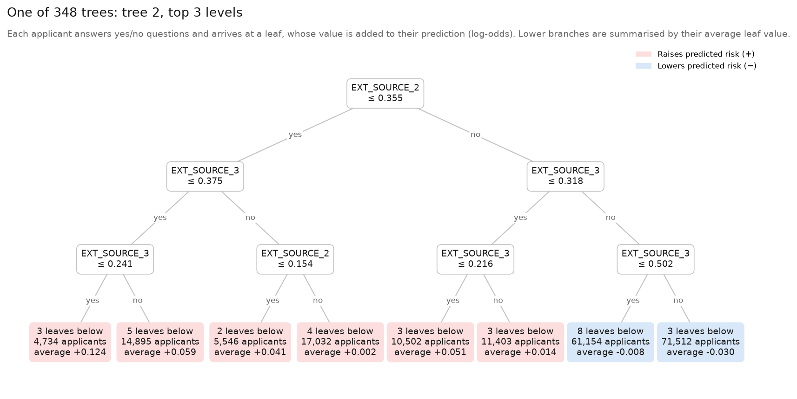
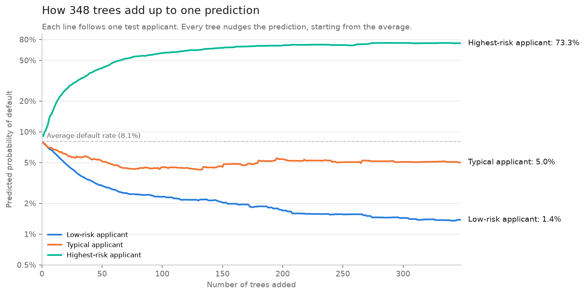

# Credit Risk PD Model — Home Credit Default Risk

This project develops a probability of default (PD) model on the Home
Credit Default Risk dataset, framed around credit-risk industry practice
and regulatory context.

The Weight of Evidence (WoE) scorecard is the industry-standard PD
modeling technique in retail credit risk, favored for its interpretability
and acceptance under Basel IRB and IFRS 9 requirements. It serves as the
primary model here. A LightGBM gradient-boosting challenger is added
alongside, with SHAP (SHapley Additive exPlanations) for global and local
explainability. An IFRS 9 Expected Credit Loss (ECL) appendix illustrates
how PD estimates translate into accounting-relevant risk indicators.

The project is structured around the CRISP-DM (Cross-Industry Standard
Process for Data Mining) framework, covering Business Understanding, Data
Understanding, Data Preparation, Modeling, and Evaluation. The Deployment
phase is out of scope: this is a demonstration model, not a
production-ready system.

**Status:** Work in progress. Notebooks 01–04 are complete: the WoE
scorecard is the primary model, and a LightGBM challenger has been evaluated
against it.

## Results

The primary model is a WoE logistic-regression scorecard with 19
characteristics, scaled to 600 points at good:bad odds of 50:1 and 20
points to double the odds. A LightGBM gradient-boosting model serves as the
challenger. Both are evaluated once on the same held-out test set (61,503
applicants):

| Model | Features | Gini | KS | Brier score |
|---|---|---|---|---|
| WoE scorecard (primary) | 19 | 0.500 | 0.370 | 0.0685 |
| LightGBM (challenger) | 96 | 0.541 | 0.402 | 0.0672 |

The Brier score of a model that predicts the average default rate for every
applicant is 0.0742.

**Scorecard:**

- The cross-validated Gini on the training set was 0.496 (std 0.006), so the
  model generalises to unseen applicants without measurable loss.
- The riskiest 20% of applicants account for about half of all defaults.
- Predicted and observed default rates agree within 0.54 percentage points
  in every decile of predicted PD, so the scores can be used as calibrated
  probabilities.

**Challenger:**

- The challenger improves the Gini by about 4 points. SHAP attributes 76% of
  its importance to the scorecard's own 19 features, so most of the gain comes
  from using the same information more flexibly.
- It over-predicts the PD of the safest applicants, so its probabilities are
  less well calibrated than the scorecard's.
- It uses age and defaults within the applicant's social circle, which the
  scorecard does not; both are examined in the fairness analysis.

The gain in discrimination comes at the cost of transparency: the scorecard
can be read as a table of points, while the challenger needs SHAP to be
explained. The full scorecard is in
[`reports/scorecard_table.csv`](reports/scorecard_table.csv), and the
model comparison in
[`reports/model_comparison_test.csv`](reports/model_comparison_test.csv).

### How the challenger works

The challenger adds up the output of 348 small decision trees. Each tree
asks a few yes/no questions about an applicant and adds a small correction to
their predicted risk. The figure below shows the top of one real tree from
the model: it combines the two external credit scores, and lowers the risk
only when both are high.



Following three test applicants as the trees are added shows how these
corrections accumulate: every prediction starts near the average default rate
and moves step by step towards its final value.



## Structure

- `notebooks/01_eda.ipynb`: Exploratory data analysis
- `notebooks/02_data_preparation.ipynb`: Cleaning, feature engineering and train/test split
- `notebooks/03_scorecard_woe_lr.ipynb`: WoE binning, feature selection, logistic regression scorecard and test evaluation
- `notebooks/04_challenger_lightgbm.ipynb`: LightGBM challenger, test comparison with the scorecard and SHAP explanations
- `notebooks/05_ifrs9_ecl.ipynb`: IFRS 9 Expected Credit Loss appendix *(planned)*
- `notebooks/06_validation.ipynb`: Model validation and fairness testing *(planned)*
- `configs/`: Fitted preparation parameters and model specifications
- `models/`: Fitted models, regenerated by notebooks 03 and 04 *(not committed)*
- `src/`: Reusable feature engineering, modeling and evaluation code
- `reports/`: Scorecard table, model comparison, calibration tables, SHAP importances, test metrics and figures; validation report and executive summary *(planned)*

## Ethical and regulatory considerations

Credit scoring is classified as a **high-risk** application under the
EU AI Act (Annex III), and automated credit decisions fall under
GDPR Article 22, which grants data subjects the right to meaningful
information about the logic involved. These considerations shape the
modeling choices in this project:

- **Interpretability first.** The WoE scorecard is chosen as the primary
  model because point-scaled logistic regression is auditable at the
  feature level, which is a regulatory expectation rather than a
  preference.
- **Protected attributes excluded.** `CODE_GENDER` is not used as a
  predictor, since EU Directive 2004/113/EC prohibits sex discrimination in
  access to goods and services. It is retained only to test the model's
  outputs for gender disparities.
- **Explainability for challengers.** SHAP is applied to the LightGBM
  model to make its predictions defensible at both the population and
  individual level.
- **Proxy discrimination.** Features that correlate with protected
  attributes (gender, age, national origin) can encode indirect bias
  even when protected attributes are excluded. A brief fairness
  discussion is included in the validation notebook (06).
- **Scope of this project.** This is a demonstration model built on a
  public dataset. It is not intended for deployment and would require
  formal model validation, independent review, and fairness testing
  before any real credit decision.

## Data

Source: [Home Credit Default Risk (Kaggle)](https://www.kaggle.com/competitions/home-credit-default-risk).

Raw data is not committed. 

See "Reproducibility" below.

## Reproducibility

Requires Python 3.12+ and a Kaggle API token.

```bash
py -3.12 -m venv .venv
.venv\Scripts\activate
pip install -r requirements.txt
kaggle competitions download -c home-credit-default-risk -p data/raw
cd data/raw && tar -xf home-credit-default-risk.zip
```

Run the notebooks in numerical order: each one reads the output of the
previous notebook from `data/processed/`.